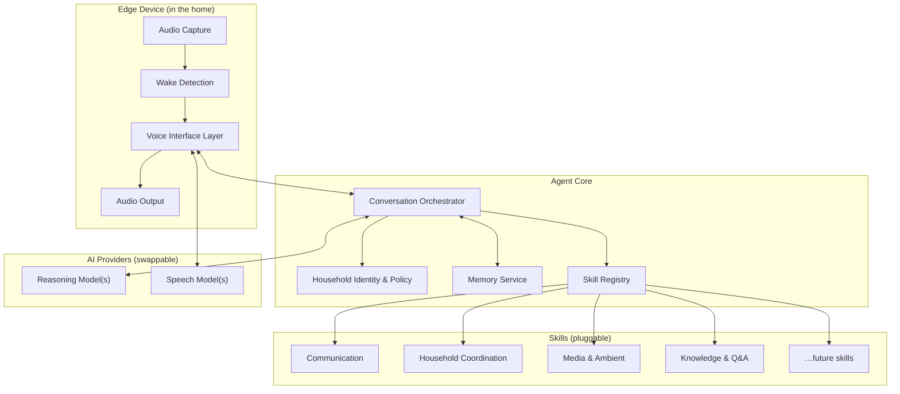
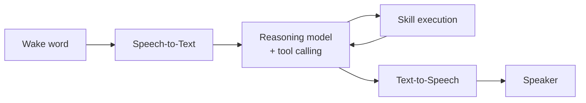
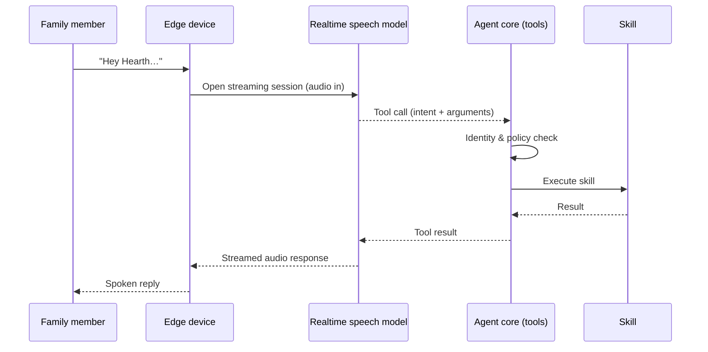
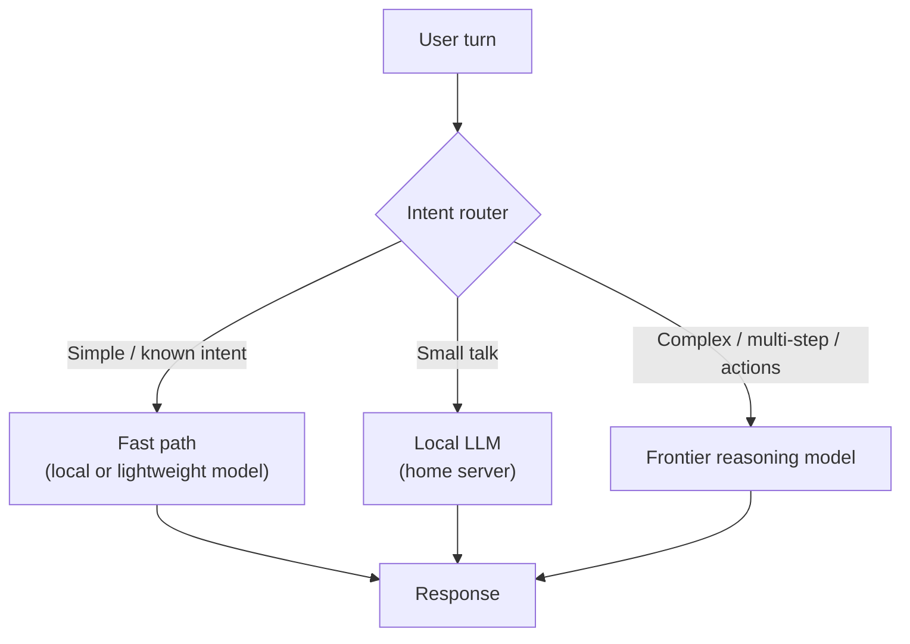
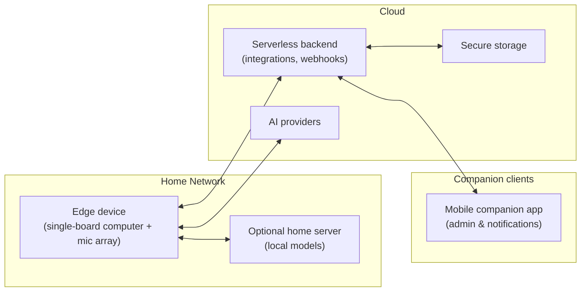

# Hearth

### A family-first, voice-native home agent — Project Proposal

> **Status:** Concept / proposal stage. This document outlines the problem, goals and candidate architectures for discussion. No implementation decisions are final.

---

## 1. Summary

**Hearth** is a proposal for a voice-first AI agent that lives in the home and serves the *whole household*, not just one account holder. Instead of a smart speaker that waits for rigid commands, Hearth would act more like a calm, context-aware household companion: it understands natural conversation, knows who it is talking to, remembers what matters, and can take real actions on the family's behalf.

The project explores three questions:

1. Can a low-cost edge device plus modern AI models deliver a genuinely *conversational* home assistant with acceptable latency and cost?
2. What does a safe, useful assistant look like when some of its users are **young children**?
3. Can the agent be built around a **pluggable skill architecture** so new capabilities are added without touching the core?

---

## 2. Problem

Today's home voice assistants share a set of limitations:

| Limitation | Effect on a family |
|---|---|
| **Command-based interaction** | Users must learn magic phrases; children and non-technical users struggle |
| **Single-identity model** | The device rarely knows *who* is speaking, so it can't personalise or apply the right permissions |
| **Stateless conversations** | Context is lost between sessions; the assistant never "remembers" the household |
| **Closed ecosystems** | Capabilities are tied to one vendor's platform and roadmap |
| **Phone-centric family communication** | Young children who don't own phones have no easy, safe way to reach a parent |
| **Opaque data handling** | Families have little visibility or control over what is stored and where |

There is room for an assistant designed *for households first*, built on open, swappable components.

---

## 3. Vision

> *"A household member you can just talk to."*

Hearth should feel less like a gadget and more like a dependable presence in the home:

- **Conversational, not command-driven** — intent is inferred from natural speech.
- **Household-aware** — recognises family members and adapts tone, permissions and content.
- **Connected to family life** — helps with coordination, communication and everyday routines.
- **Extensible** — new abilities are added as self-contained skills.
- **Respectful by design** — clear boundaries on what is stored, who can access it, and how children are protected.

---

## 4. Goals and Non-Goals

### Goals

- G1 — Deliver a natural, low-latency voice interaction loop on affordable hardware.
- G2 — Design a **skill framework** where capabilities are discoverable, isolated and independently deployable.
- G3 — Support **multiple household members** with role-based permissions (e.g. parent, child, guest).
- G4 — Provide a **memory model** that lets the agent carry useful context across conversations.
- G5 — Keep the AI layer **provider-agnostic** so models can be swapped as the landscape evolves.
- G6 — Treat child safety and family privacy as first-class requirements, not afterthoughts.

### Non-Goals (initial phases)

- Replacing a full home-automation platform.
- Commercial productisation or multi-tenant hosting.
- Building custom foundation models.
- Video / camera-based perception.

---

## 5. Users and Personas

| Persona | Needs | Considerations |
|---|---|---|
| **Parent / Administrator** | Configure the system, manage skills, oversee household data | Full permissions; owns integrations and policies |
| **Partner / Adult member** | Everyday help, coordination, communication | Personalised context; shared household data |
| **Young child** | Simple, friendly help; a way to reach a parent without a phone | Restricted skills, age-appropriate responses, no unsupervised external actions |
| **Guest** | Basic, low-risk help | No access to household memory or personal integrations |

---

## 6. Guiding Principles

1. **Voice is the primary interface; screens are optional.**
2. **The core is small; capabilities live in skills.**
3. **Every external provider sits behind an interface.** No vendor lock-in at the architecture level.
4. **Escalate intelligence only when needed.** Cheap and fast for simple turns; powerful models for complex reasoning.
5. **Least privilege per speaker.** What the agent may do depends on who is asking.
6. **Fail gracefully and audibly.** The household should always know when something didn't work.
7. **Phase-based delivery.** Get a working core first, optimise later.

---

## 7. Architectural Proposals

### 7.1 Logical Architecture

Regardless of which option is chosen, the system decomposes into the same logical layers:



The three proposals below differ mainly in **how the voice and reasoning layers are composed** and **where inference runs**.

---

### 7.2 Proposal A — Cascaded Pipeline ("Thin Edge, Cloud Brain")

A classic, modular pipeline: each stage is a separate, replaceable component.



**How it works:** The edge device handles wake detection and audio I/O. Transcription, reasoning and speech synthesis are discrete services; the reasoning model selects and invokes skills via tool calls.

| Strengths | Weaknesses |
|---|---|
| Maximum modularity — swap any stage independently | Latency accumulates across stages |
| Easy to debug: every stage produces inspectable text | Loses prosody and emotional nuance at the STT boundary |
| Mature, well-documented components | Several vendors / bills to manage |
| Transcripts are naturally available for memory and audit | Harder to support interruptions ("barge-in") smoothly |

**Best fit:** Early prototyping, learning, and environments where transparency matters more than speed.

---

### 7.3 Proposal B — Realtime Speech-Native Agent

A single realtime, multimodal model handles listening, understanding and speaking over one streaming connection. Hearth's own logic is exposed to that model as **tools**.



**How it works:** The edge device streams audio to a speech-native model. The model decides when to call Hearth's tools; the **agent core remains the authority** for identity, permissions, memory and skill execution.

| Strengths | Weaknesses |
|---|---|
| Lowest perceived latency; natural turn-taking and interruptions | Tighter coupling to a provider's realtime API |
| Preserves tone and expressiveness | Less visibility into intermediate reasoning |
| Fewer moving parts and fewer vendors | Complex multi-step reasoning may be weaker than dedicated reasoning models |
| Simpler edge code | Session cost model needs careful monitoring |

**Best fit:** The most natural household experience, provided the tool boundary is kept clean so the provider can be replaced.

---

### 7.4 Proposal C — Tiered Hybrid Inference

A routing layer decides, per turn, how much intelligence is needed.



**How it works:** Simple, high-frequency requests resolve on a fast path or a local model running on hardware in the home. Only ambiguous, multi-step or action-heavy turns escalate to a cloud frontier model.

| Strengths | Weaknesses |
|---|---|
| Lower running cost at scale | Router itself must be accurate — mis-routing hurts UX |
| More processing stays inside the home | More infrastructure to operate |
| Graceful degradation if the internet is unavailable | Requires evaluation data to tune thresholds |
| Best-of-both: speed for simple turns, power for hard ones | Highest overall complexity |

**Best fit:** A mature system optimising for cost, resilience and privacy.

---

### 7.5 Comparison

| Criterion | A — Cascaded | B — Realtime | C — Hybrid |
|---|:---:|:---:|:---:|
| Perceived latency | ●●○ | ●●● | ●●○ |
| Conversational naturalness | ●○○ | ●●● | ●●○ |
| Modularity / swappability | ●●● | ●●○ | ●●● |
| Debuggability | ●●● | ●○○ | ●●○ |
| Operating cost | ●●○ | ●●○ | ●●● |
| Privacy / offline resilience | ●○○ | ●○○ | ●●● |
| Implementation complexity (lower is better) | ●●○ | ●●● | ●○○ |

### 7.6 Recommended Direction

**Build a provider-agnostic agent core first, then evaluate A and B side-by-side behind the same interfaces, and evolve toward C.**

- The **agent core** (identity, policy, memory, skill registry) is the durable investment and is identical across all three options.
- A **Voice Interface Layer** abstraction lets the cascaded pipeline (A) and a realtime model (B) be benchmarked against each other on real household usage.
- Once usage patterns and evaluation data exist, a **router** (C) can be introduced to optimise cost and resilience without redesigning anything upstream.

---

## 8. Cross-Cutting Design Concepts

### 8.1 Skill Framework

Each capability is a self-contained skill that declares what it does, what it needs, and who may use it. The core discovers skills at startup and exposes them to the AI layer as tools.

Illustrative manifest (conceptual):

```yaml
name: example-skill
version: 0.1.0
description: One-line, model-readable description of when to use this skill
permissions:
  allowed_roles: [parent, adult]
  requires_confirmation: true
inputs:
  - name: target
    type: string
    description: Who or what the action applies to
dependencies:
  secrets: [EXAMPLE_PROVIDER_TOKEN]
```

Design goals:

- **Isolation** — a failing skill cannot crash the core.
- **Declarative permissions** — policy is enforced by the core, not by each skill.
- **Hot-pluggability** — adding a skill requires no changes to orchestration code.
- **Testability** — each skill has a contract test harness independent of the voice stack.

### 8.2 Household Identity and Policy

- Household members are modelled with **roles** (parent, adult, child, guest).
- Identity could be established through layered signals: explicit introduction, voice characteristics, device context, and conversational cues — with a safe default of *least privilege* when uncertain.
- A central **policy engine** evaluates every skill invocation against the speaker's role before execution.

### 8.3 Memory Model

A tiered approach, inspired by how people remember:

| Tier | Purpose | Lifetime |
|---|---|---|
| **Working** | Context within the current conversation | Session |
| **Recent** | Summaries of recent interactions so conversations can be resumed | Short, rolling window |
| **Long-term** | Durable household facts and explicitly saved information | Until removed |

A **consolidation** process would periodically promote useful information from recent to long-term memory, and household members could ask the agent to remember or forget things.

### 8.4 Safety and Child-Appropriate Behaviour

- Role-aware response styling (simpler language, friendlier tone for children).
- Restricted skill sets and **mandatory confirmation** for consequential actions.
- No external actions on a child's behalf beyond explicitly allow-listed, parent-approved flows.
- Content guardrails applied at the orchestrator level, independent of the model provider.

### 8.5 Privacy and Data Governance

- Wake detection runs locally; audio is only streamed after activation.
- Clear separation between transient audio and stored memory.
- Parent-accessible view of stored memory with the ability to delete.
- Secrets managed outside the codebase; least-privilege credentials per skill.

### 8.6 Observability

- Structured, per-turn tracing: wake → intent → skill → response, with latency per stage.
- Cost tracking per provider and per skill.
- An evaluation set of representative household requests used to regression-test changes and provider swaps.

---

## 9. Deployment Topology (Proposed)



- **Edge:** affordable single-board computer with a far-field microphone array and speaker.
- **Optional home server:** runs local models for Proposal C.
- **Cloud:** lightweight serverless functions for integrations and notifications; no always-on servers required.
- **Companion app:** household administration, notifications, and visibility into the agent's activity.
- **CI/CD:** automated build, test and deployment pipelines for both edge and cloud components.

---

## 10. Delivery Roadmap

| Phase | Focus | Outcome |
|---|---|---|
| **0 — Discovery** | Hardware selection, latency and cost benchmarks, provider evaluation | Validated assumptions and a chosen starting option |
| **1 — Voice Loop** | Wake → understand → respond, end-to-end | A conversational device in the home |
| **2 — Skill Framework** | Skill contract, registry, first set of household skills | Extensible platform |
| **3 — Identity & Memory** | Household roles, policy engine, tiered memory | Personalised, context-aware agent |
| **4 — Hybrid Intelligence** | Intent routing, local model integration | Lower cost, better resilience |
| **5 — Hardening** | Observability, evaluation suite, safety review, companion app | Reliable daily-use system |

---

## 11. Success Metrics

| Metric | Target (initial) |
|---|---|
| Time from end of speech to first audio response | < 1.5 s for common requests |
| Wake word false activations | < 1 per day in a normal household |
| Task success rate on household evaluation set | ≥ 90% |
| Child-initiated requests completed without adult help | ≥ 80% for supported tasks |
| Time to add a new skill | < 1 day for a simple integration |
| Monthly running cost | Defined and tracked from Phase 1 |

---

## 12. Risks and Mitigations

| Risk | Mitigation |
|---|---|
| Latency makes conversation feel unnatural | Benchmark early (Phase 0); keep realtime option (B) on the table |
| Provider lock-in or pricing changes | Strict interface boundaries; evaluation suite enables swaps |
| Misidentifying the speaker | Least-privilege defaults; confirmation for sensitive actions |
| Inappropriate responses to children | Role-aware guardrails at the orchestrator level |
| Memory storing things it shouldn't | Explicit retention rules; parent-visible memory with deletion |
| Noisy home acoustics | Far-field mic array; tunable wake sensitivity |
| Scope creep | Phased roadmap; skills added only after the core is stable |

---

## 13. Open Questions

1. Which voice architecture (A or B) gives the best balance of naturalness and reliability in a real family environment?
2. How reliable can lightweight speaker identification be on low-cost hardware, and is it reliable enough to drive permissions?
3. What is the right boundary between local and cloud inference for cost, privacy and quality?
4. How should memory consolidation decide what is worth keeping?
5. What is the minimal companion-app surface needed for parents to feel in control?

---

## 14. Why This Project

Hearth sits at the intersection of several current and practical engineering themes — **agentic AI with tool use, realtime voice interfaces, edge computing, pluggable architectures, and responsible AI design for vulnerable users**. It is small enough to prototype on inexpensive hardware, yet rich enough to explore real architectural trade-offs and produce reusable patterns for any domain that needs a safe, extensible voice agent.

---

*This is a living proposal. Feedback, questions and alternative architectures are welcome.*
